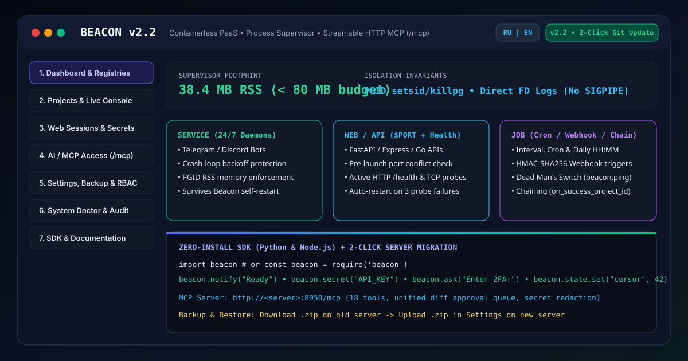

> 🌐 **Язык / Language:** [English (README.md)](README.md) | **Русский**

# Beacon — Containerless PaaS, супервизор процессов и MCP-сервер (`< 80 МБ ОЗУ`)

[](LICENSE)
[](https://www.python.org/)
[](#быстрый-старт-установка-в-1-команду)
[](#доступ-для-ии-агентов-mcp-и-rest-api)

**Beacon** — автономная ультралегковесная панель управления процессами и серверная консоль (**Containerless PaaS**, `< 80 МБ ОЗУ` в простое) для круглосуточного (24/7) запуска Telegram/Discord-ботов (`service`), веб-сервисов и API (`web`) и задач по расписанию/вебхукам (`job`) на Linux VPS, Raspberry Pi (`x86_64` / `aarch64`) и домашних серверах на базе Android (`chroot` / Termux) **без использования Docker**. В отличие от тяжёлых контейнерных платформ или базовых менеджеров процессов (`PM2`, `supervisord`, голый `systemd`), Beacon пишет логи напрямую в файловые дескрипторы на диске (`buffering=0`, без падений от `SIGPIPE` при перезапуске самой панели), изолирует деревья процессов через `os.setsid`/`os.killpg` и включает готовый SDK (`import beacon`), защищённое `0600`-хранилище секретов и сессий `Cookie-Editor`, переезд между серверами в 2 клика через загрузку `.zip`-бэкапа и встроенный **Streamable HTTP MCP-сервер (`/mcp`)** для ИИ-агентов.



> 📸 *Скриншоты и схемы архитектуры находятся в папке [`docs/assets/`](docs/assets/). Веб-интерфейс поддерживает мгновенное переключение языка **`RU | EN`** в верхней панели.*

---

## Содержание

- [Преимущества Beacon перед аналогами](#преимущества-beacon-перед-аналогами)
- [Быстрый старт (установка в 1 команду)](#быстрый-старт-установка-в-1-команду)
- [Базовый сценарий использования](#базовый-сценарий-использования)
- [Обновление и переезд на другой сервер в 2 клика (Бэкап / Восстановление)](#обновление-и-переезд-на-другой-сервер-в-2-клика-бэкап--восстановление)
- [Архитектурные инварианты супервизора](#архитектурные-инварианты-супервизора)
- [Встроенный SDK (`import beacon` / `require('beacon')`)](#встроенный-sdk-import-beacon--requirebeacon)
- [Доступ для ИИ-агентов (MCP `/mcp` и REST `/api/v1/`)](#доступ-для-ии-агентов-mcp-mcp-и-rest-apiv1)
- [Справочник команд CLI](#справочник-команд-cli)
- [Переменные окружения](#переменные-окружения)
- [Безопасность и документация](#безопасность-и-документация)
- [Лицензия](#лицензия)

---

## Преимущества Beacon перед аналогами

| Возможность | Docker / Coolify / CapRover | PM2 / supervisord | **Beacon** |
|---|---|---|---|
| **Потребление ОЗУ в простое** | `300–1200+ МБ` | `45–120 МБ` | **`< 80 МБ`** (умеет работать даже на чистой stdlib Python) |
| **Работа в Android `chroot` / Termux (без `systemd` и cgroups)** | ❌ | ⚠️ Частично | **✅ Нативно (сохраняет сетевые группы `aid_inet` 3003 / `aid_net_raw` 3004)** |
| **Выживаемость ботов при рестарте панели (`No SIGPIPE`)** | ❌ Рестарт контейнера | ⚠️ Риск обрыва пайпа | **✅ Прямая запись в FD (`buffering=0`) + переподхват по PID/create_time** |
| **Встроенный SDK (алерты, секреты, 2FA-ввод, KV-состояние)** | ❌ | ❌ | **✅ `import beacon` / `require('beacon')` из коробки** |
| **Встроенный MCP-сервер (`/mcp`) с одобрением `unified diff`** | ❌ | ❌ | **✅ 18 инструментов, очередь одобрения правок, фильтрация секретов** |
| **Обновление из Git и переезд через `.zip`-бэкап в 2 клика** | ⚠️ Внешние утилиты | ❌ | **✅ Прямо в веб-интерфейсе** |

---

## Быстрый старт (установка в 1 команду)

### Вариант 1: Автоматическая установка в 1 команду (Ubuntu / Debian / Raspberry Pi / Android Chroot)

```bash
curl -fsSL https://raw.githubusercontent.com/VoidAruta/Beacon/main/scripts/install.sh | sudo bash
```

Установщик идемпотентен: автоматически клонирует репозиторий в `/opt/beacon` (если запущен через `curl | bash`), создаёт непривилегированного пользователя `beacon-runner`, настраивает `.venv`, инициализирует SQLite БД в режиме WAL, выполняет самодиагностику `python3 -m beacon doctor` и регистрирует `beacon.service` в `systemd` (либо запускает фоновый демон через `scripts/zstart_line.sh` в `chroot`/контейнерах без `systemd`).

### Вариант 2: Ручной запуск из исходников

```bash
git clone https://github.com/VoidAruta/Beacon.git beacon
cd beacon
pip install -r requirements.txt
python3 -m beacon --port 8050
```

> **Примечание:** собранная статика фронтенда уже включена в `hub/static/`, поэтому Node.js на боевом сервере **не требуется**. Если вы изменяете исходники интерфейса в `src/`, выполните `npm install && npm run build`.

### Вариант 3: Запуск в Docker Compose (опционально)

```bash
docker compose up -d --build
```

### Первый вход в панель
1. Откройте **`http://127.0.0.1:8050`** (или IP вашего сервера в локальной сети / Tailscale).
2. Войдите со стартовым паролем: **`admin`**.
3. Перейдите во вкладку **«5. Настройки, пароль и RBAC»** и установите новый пароль (минимум 8 символов).
   - *Защита при первом запуске:* пока действует пароль `admin`, панель показывает предупреждающий баннер, разрешает вход только из локальных подсетей (`127.0.0.0/8`, `192.168.0.0/16`, `10.0.0.0/8`, `172.16.0.0/12`) и блокирует ИИ-доступ (`/mcp`).

---

## Базовый сценарий использования

1. **Создайте или импортируйте проект:**
   - Откройте **«2. Проекты и Консоль»** → нажмите **`+ Новый проект`** (или импортируйте `.zip`-архив / Git-репозиторий).
   - Выберите тип нагрузки:
     - **`service` (Сервис)** — постоянные демоны 24/7 и Telegram/Discord-боты с защитой от `crash-loop` (`restart_policy`, `min_uptime_sec`, `max_restarts`).
     - **`web` (Веб / API)** — HTTP-серверы с пробросом `$PORT`, проверкой занятости порта до старта и активным HTTP `/health` или TCP-пингом.
     - **`job` (Задача)** — периодические скрипты (`interval`, `cron`, `daily ЧЧ:ММ`), запуск по вебхуку с HMAC-SHA256 (`/api/webhook/{token}`), контроль **Dead Man's Switch** (`/api/ping/{token}`) и цепочки запуска (`on_success_project_id`).
2. **Привяжите секреты и cookies:**
   - Во вкладке **«3. Веб-сессии и Секреты»** сохраните API-ключи (`text`), JSON-экспорт из браузерного расширения `Cookie-Editor` (`cookie_json`) или бинарные файлы сессий/ключей (`file`) с правами `0600`. Секреты не попадают в `/proc/<pid>/environ` и автоматически маскируются (`***SECRET:<имя>***`) в логах.
3. **Запустите и контролируйте в реальном времени:**
   - Нажмите контекстную кнопку запуска (**«Запустить сервис»**, **«Запустить HTTP»** или **«Запустить сейчас»**). Читайте live-логи по SSE, отправляйте команды в `stdin` или редактируйте ключи в **«KV-хранилище»**.

---

## Обновление и переезд на другой сервер в 2 клика (Бэкап / Восстановление)

### Обновление панели в 2 клика (Self-Update)
1. Нажмите кнопку **`v2.2 / Обновить`** в верхней панели.
2. Нажмите **«1. Проверить обновления в Git»**, а затем **«2. Обновить панель (с авто-бэкапом)»** — Beacon создаст резервную копию в `data/backups/`, выполнит `git pull --ff-only`, применит миграции SQLite и перезапустит веб-сервер без остановки работающих дочерних процессов.

### Переезд на другой сервер в 2 клика (Backup & Restore)
1. **На старом сервере:** откройте **«5. Настройки → Резервное копирование и Systemd»** и нажмите **«Скачать полный бэкап (.zip)»** (в архив входят `data/hub.db`, все секреты `data/secrets/*` с правами `0600` и код всех проектов `projects/*`).
2. **На новом сервере:** установите Beacon, откройте **«5. Настройки → Резервное копирование и Systemd → Загрузка и восстановление бэкапа»**, выберите ваш `.zip`-архив (или один из архивов в `data/backups/`) и нажмите **«Восстановить из архива»**. Панель автоматически сохранит страховочную копию текущего состояния (`beacon_pre_restore_<ts>.zip`), проверит целостность SQLite (`PRAGMA integrity_check`), остановит текущие процессы и восстановит все проекты и секреты.

---

## Архитектурные инварианты супервизора

1. **Изоляция групп процессов (`os.setsid` / `os.killpg`):** каждый проект запускается в собственной группе процессов (`PGID`). При остановке сигналами `SIGTERM` → (5 с) → `SIGKILL` гарантированно завершается всё дерево дочерних процессов без процессов-зомби.
2. **Прямой вывод логов в файловый дескриптор (`buffering=0`, без `subprocess.PIPE`):** `stdout` и `stderr` дочернего процесса пишутся напрямую в открытый файловый дескриптор на диске. Перезапуск или обновление самого Beacon не вызывает `SIGPIPE` у запущенных 24/7-ботов.
3. **Подхват выживших процессов (`recover_running_processes`):** при старте Beacon сверяет `pid` и время создания процесса (`abs(psutil.Process(pid).create_time() - proc_create_time) < 0.5`) с учётом `ECHILD`.
4. **Контроль памяти по сумме RSS группы `PGID` (без `RLIMIT_AS`):** лимит памяти проверяется по реальному физическому RSS группы процессов без `RLIMIT_AS`, который ломает V8/Node.js и многопоточный Python на `aarch64`.
5. **Бережная работа с накопителем и памятью:** SQLite работает в режиме `WAL` (`synchronous=NORMAL`), чтение хвоста логов выполняется через `os.SEEK_END` за `O(1)`, а сам процесс Beacon в простое потребляет **< 80 МБ ОЗУ**.

---

## Встроенный SDK (`import beacon` / `require('beacon')`)

Во всех проектах пути к SDK (`PYTHONPATH` и `NODE_PATH`) подключаются автоматически — устанавливать внешние пакеты не нужно.

### Python (`import beacon`)

```python
import beacon

# 1. Отправка уведомления владельцу в Telegram / ntfy / Webhook ("info" | "warn" | "error")
beacon.notify("Парсер запущен", level="info")

# 2. Чтение секрета (строкой, распарсенным списком Cookie-Editor или путём к файлу 0600)
api_key = beacon.secret("OPENWEATHER_KEY")
cookies = beacon.secret("my-parser_cookies")
key_path = beacon.secret("SSH_PRIVATE_KEY", as_path=True)

# 3. Запрос интерактивного ввода у владельца (2FA / SMS / капча) через веб-панель или Telegram
code = beacon.ask("Введите 6-значный код подтверждения:", timeout=300)

# 4. Пометка о протухших cookies (включает тревожный баннер в UI и шлёт алерт в Telegram)
beacon.cookies_expired("my-parser_cookies", note="HTTP 403 при запросе /api/profile")

# 5. Сигнал Dead Man's Switch
beacon.ping()

# 6. Персистентное SQLite KV-хранилище состояния проекта
cursor = beacon.state.get("last_id", default=0)
beacon.state.set("last_id", cursor + 1)
beacon.state.delete("temp_lock")
```

### Node.js (`const beacon = require('beacon')`)

```javascript
const beacon = require('beacon');

async function main() {
  await beacon.notify('Воркер запущен', 'info');
  const token = await beacon.secret('API_TOKEN');
  const cursor = await beacon.state.get('cursor', 0);
  await beacon.state.set('cursor', cursor + 10);
  await beacon.ping();
}

main();
```

---

## Доступ для ИИ-агентов (MCP `/mcp` и REST `/api/v1/`)

Beacon содержит встроенный сервер **Model Context Protocol (Streamable HTTP)** на `/mcp` и REST API на `/api/v1/` (OpenAPI 3.1 схема доступна на `/api/v1/openapi.json`).

```bash
# Подключение Claude Code к Beacon MCP
claude mcp add --transport http beacon http://<IP-СЕРВЕРА>:8050/mcp \
  --header "Authorization: Bearer beacon_ai_ВАШ_ТОКЕН"
```

- **18 MCP-инструментов:** `list_projects`, `get_project`, `get_run_status`, `tail_logs`, `list_runs`, `list_schedules`, `get_device_health`, `run_doctor`, `list_files`, `read_file`, `write_file`, `start_project`, `stop_project`, `restart_project`, `install_dependencies`, `update_schedule`, `create_project_from_template`, `answer_ask`.
- **Очередь одобрений (Human-in-the-Loop):** запись файлов, изменение расписания и создание проектов из шаблона формируют заявку с визуальным `unified diff`, которую владелец одобряет в один клик.
- **Защита от Prompt Injection и Kill-Switch:** логи очищаются от секретов и оборачиваются в `<untrusted_content>`, а кнопка **«Пауза ИИ»** (`python3 -m beacon ai-pause`) мгновенно блокирует все ИИ-токены.
- Подробнее: [`docs/AI-ACCESS.md`](docs/AI-ACCESS.md) и [`docs/AI-CODER-GUIDE.md`](docs/AI-CODER-GUIDE.md).

---

## Справочник команд CLI

```bash
python3 -m beacon --host 0.0.0.0 --port 8050   # Стандартный запуск сервера
python3 -m beacon --safe-mode --port 8050      # Запуск в Safe Mode без автостарта проектов
python3 -m beacon doctor                       # Самодиагностика окружения, прав и безопасности
python3 -m beacon migrate                      # Применение миграций SQLite и перенос старых установок
python3 -m beacon backup                       # Создание полного .zip бэкапа в data/backups/
python3 -m beacon restore <путь/к/backup.zip>  # Восстановление БД, секретов 0600 и проектов
python3 -m beacon reset-password               # Сброс пароля администратора через терминал
python3 -m beacon systemd                      # Генерация unit-файла data/generated/beacon.service
python3 -m beacon ai-pause / ai-resume         # Экстренная блокировка / разблокировка ИИ-доступа
```

---

## Переменные окружения

Полный шаблон находится в файле [`.env.example`](.env.example):

| Переменная | По умолчанию | Описание |
|---|---|---|
| `BEACON_DIR` | `/opt/beacon` (или корень репозитория) | Базовая директория `data/`, `projects/` и логов |
| `BEACON_HOST` | `0.0.0.0` | Хост привязки HTTP-сервера |
| `BEACON_PORT` | `8050` | Порт веб-панели |
| `BEACON_ADMIN_PASSWORD` | `admin` | Начальный пароль администратора при создании БД |
| `BEACON_ALLOWED_SUBNETS` | RFC1918 + loopback | Разрешённые подсети клиентов для веб-панели и API |
| `BEACON_TRUSTED_PROXIES` | `127.0.0.1/32,::1/128` | Доверенные CIDR обратных прокси для `X-Forwarded-For` |
| `BEACON_SAFE_MODE` | `0` | Установите `1`, чтобы отключить автозапуск проектов при старте |

---

## Безопасность и документация

- **Политика безопасности:** [`SECURITY.md`](SECURITY.md)
- **Руководство для контрибьюторов:** [`CONTRIBUTING.md`](CONTRIBUTING.md)
- **История изменений:** [`CHANGELOG.md`](CHANGELOG.md)
- **Подключение ИИ-агентов (MCP и REST):** [`docs/AI-ACCESS.md`](docs/AI-ACCESS.md)
- **Руководство по разработке скриптов под Beacon:** [`docs/AI-CODER-GUIDE.md`](docs/AI-CODER-GUIDE.md)

### Запуск тестов

```bash
python3 -m unittest discover -s tests -v
npx tsx --test src/utils/hubLogic.test.ts
```

---

## Лицензия

Проект распространяется под лицензией [MIT License](LICENSE).
